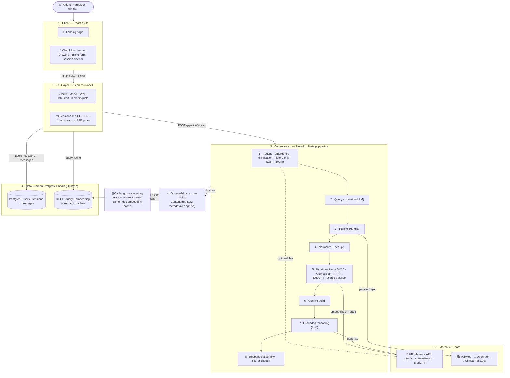

# Curalink — AI Medical Research Assistant

An AI-powered medical research companion built with React, Express, Neon Postgres, and a FastAPI orchestrator. Curalink uses de-identified patient context to retrieve research from PubMed, OpenAlex, and ClinicalTrials.gov, reasons over it with a configurable LLM (Hugging Face Inference API or Cloudflare Workers AI), and delivers structured answers with sources users can inspect.

> **Multi-provider LLM**: `LLM_MODEL` selects the platform-funded default (`CLOUDFLARE` or a Hugging Face model ID). Users with validated own keys choose either answer provider in Settings. On a Cloudflare-default server, own-key Hugging Face requests use `HF_FALLBACK_MODEL` (default: `meta-llama/Llama-3.3-70B-Instruct`).

## Features

- **Structured intake + natural chat** — fill disease/intent once, then chat naturally; follow-ups inherit context automatically
- **7-stage AI pipeline** — query expansion → parallel retrieval → normalization → hybrid re-ranking → context building → LLM reasoning → response assembly
- **Three current medical sources** — cache misses query PubMed, OpenAlex, and ClinicalTrials.gov in parallel (~170 unique candidates per query)
- **Domain-specialized ranking** — BM25 + PubMedBERT embeddings fused via Reciprocal Rank Fusion, refined by a MedCPT cross-encoder with source-balanced selection
- **Inspectable sources** — research findings and personalized recommendations include titles, authors, years, URLs, and supporting excerpts for verification against the original publications
- **Emergency boundary** — urgent-use messages are diverted from the research pipeline to immediate emergency-services guidance
- **Real-time SSE streaming** — live pipeline progress + token-by-token LLM output through FastAPI → Express → React
- **Multi-turn context awareness** — chat history and static form context are merged into every query expansion
- **Clinical trial geo-filtering** — optional location input geocodes and filters trials within 100 miles via ClinicalTrials.gov geo API
- **Optional patient name** — use a nickname or initials to label a session. The field is saved as `session.patientName` separately from research context, displayed when reopening the session, and excluded from AI/retrieval requests and answer-cache inputs. Existing databases receive the column through schema bootstrap on backend startup.
- **Privacy controls** — de-identified-use policy, 90-day session/message retention, per-session deletion, and complete account deletion from the UI
- **Tab-scoped sessions** — login lives only in the current browser tab (`sessionStorage`); closing the tab logs out, 1-hour access tokens renew automatically while the tab is open, and logout revokes renewal tokens
- **Bring your own API keys** — choose Hugging Face or Cloudflare for answers in Settings. A Hugging Face token funds ranking for either choice; Cloudflare also needs an account ID and token. Keys are validated and stored encrypted on the account, never returned to the browser, and reused after login. Save and use a provider or reuse its saved credentials without re-entering keys; remove active credentials in Settings to return to free credits. Complete, valid selected keys hide daily credits and bypass the free question cap.
- **ChatGPT-style session sidebar** — click any past session to reopen it and keep asking; new messages append to that session's history
- **Landing page** — two-column hero with the pitch and sign-up on the left, and the animated research demo plus headline metrics (answer relevancy 91%, faithfulness 99%, cost per query $0.0015) on the right
- **Responsive authenticated UI** — collapsed mobile navigation and diagnostics overlays verified at 390px and 430px widths
- **Private service boundary** — a shared `INTERNAL_API_KEY` protects non-health FastAPI endpoints from direct public use
- **Redis caching** — tenant-isolated exact + semantic query caches, document embeddings, and prompt-level responses on Upstash with a Postgres query-cache fallback
- **Per-user credits + rate limiting** — 5 questions/day (DAILY_MESSAGE_CAP) on platform keys, waived for users who bring their own keys, plus per-IP / per-user limits on auth, chat, and session creation
- **Observability** — content-free LLM metadata to Langfuse over OTLP
- **CI/CD + Docker** — GitHub Actions (lint, syntax, build, image builds, gated Render deploy) and Dockerfiles for all three services
- **Reliability (v1)** — Retry-After headers, graceful shutdown, idempotency keys, history summarization, user account deletion, 90-day data retention, structured output validation with repair, jittered retries, prompt-level LLM cache
- **Scale modules (v2)** — async jobs, queue/backpressure/fairness, checkpoints, job-event replay, token-aware limits, content-free telemetry, signed webhooks, audit logs, token budgets, egress controls, and correlation IDs; optional fallback wiring is pending

## 🏗️ Architecture

React frontend → Express API → FastAPI pipeline, backed by Postgres, Redis
and external research/AI services.



### Pipeline Stages (inside FastAPI)

| Stage | Module | Description |
|-------|--------|-------------|
| 1 | `query_router.py` `routing.py` | Emergency/clarification/history-only/RAG route; optional Jev 8B vs 70B; history-only can skip retrieval |
| 2 | `query_expander.py` | LLM rewrites the current question; extra queries are side-effect search |
| 3 | `pubmed.py` `openalex.py` `trials.py` | Parallel retrieval from 3 sources (~210 raw → ~170 after dedupe) |
| 4 | `normalizer.py` `merger.py` | Unify schemas into `Document[]`, dedupe by DOI/PMID/NCT-ID, quality filter |
| 5 | `ranker.py` | BM25 pre-filter → PubMedBERT cosine → RRF fusion → MedCPT cross-encoder → source-balanced top 14 |
| 6 | `context_builder.py` | Patient-facing prompt with citation anchors `[doc1]` and grounding rules |
| 7 | `llm_reasoner.py` | Routed 8B or 70B via HF or Cloudflare — source-constrained generation |
| 8 | `response_assembler.py` | Citation resolution, snippet extraction, structured JSON assembly |

## Project Structure

```
curalink-medical-assistant/
├── frontend/                      # React (Vite) UI
│   └── src/
│       ├── components/
│       │   ├── AuthPage.jsx       # Login / signup form
│       │   ├── Sidebar.jsx        # Session list sidebar
│       │   ├── IntakeForm.jsx     # De-identified patient context (disease, intent, general location)
│       │   ├── LegalPage.jsx      # Privacy notice + terms of use
│       │   ├── ApiKeySettings.jsx # Own-API-key settings popup
│       │   ├── ChatView.jsx       # Chat interface with message bubbles
│       │   ├── StructuredResponse.jsx  # Renders overview + insights + trials
│       │   ├── InsightCard.jsx    # Individual research insight with sources
│       │   ├── TrialCard.jsx      # Clinical trial card with NCT ID + status
│       │   ├── PipelineProgress.jsx   # Real-time stage progress indicator
│       │   └── PipelinePanel.jsx  # Detailed pipeline metadata panel
│       ├── hooks/
│       │   ├── useAuth.js         # JWT auth state management
│       │   └── useChat.js         # Chat + SSE streaming logic
│       ├── session.js             # Tab-scoped tokens and token renewal
│       └── App.jsx                # Root component with routing
│
├── backend-node/                  # Express API (thin layer)
│   ├── index.js                   # Server entry, health check, CORS
│   ├── own_keys.js                # Validates and forwards user-supplied provider keys
│   ├── provider_settings.js       # Encrypted account credentials and provider selection
│   ├── routes/
│   │   ├── auth.js                # Signup, login, token refresh, logout, current user
│   │   ├── session.js             # POST /api/session, GET /api/sessions
│   │   └── chat.js                # POST /api/chat/stream (SSE proxy to FastAPI)
│   ├── db.js                      # Postgres pool, schema bootstrap, retention purge, row mappers
│   └── middleware/
│       └── auth.js                # JWT verification middleware
│
├── backend-python/                # FastAPI orchestrator (AI pipeline)
│   ├── main.py                    # FastAPI app, /pipeline/run, /pipeline/stream
│   ├── own_keys.py                # Verifies user-supplied provider keys
│   ├── llm_backend.py             # LLMBackend abstraction (HF + Cloudflare, multi-provider)
│   ├── sources/
│   │   ├── pubmed.py              # PubMed E-utilities (esearch + efetch)
│   │   ├── openalex.py            # OpenAlex works search
│   │   ├── trials.py              # ClinicalTrials.gov v2 API
│   │   ├── normalizer.py          # Source-specific → unified Document
│   │   ├── merger.py              # Cross-source dedupe + merge
│   │   └── geocode.py             # Nominatim geocoding for trial geo-filter
│   ├── schemas/
│   │   └── document.py            # Unified Document dataclass
│   ├── embeddings/
│   │   └── embedder.py            # PubMedBERT embeddings via HF Inference API
│   ├── routing.py                 # Jev route + model-tier helper
│   ├── ranking/
│   │   ├── ranker.py              # Full ranking pipeline orchestration
│   │   ├── bm25.py                # BM25 sparse scoring
│   │   ├── cosine.py              # Dense cosine similarity
│   │   ├── rrf.py                 # Reciprocal Rank Fusion
│   │   ├── boosts.py              # Recency + multi-source credibility boosts
│   │   ├── cross_encoder.py       # MedCPT cross-encoder via HF API
│   │   └── mmr.py                 # Maximal Marginal Relevance (diversity)
│   ├── stages/
│   │   ├── query_router.py        # Stage 1: route + model choice
│   │   ├── history_context.py     # Bounded history evidence for routing
│   │   ├── query_expander.py      # Stage 2: LLM-based query expansion
│   │   ├── context_builder.py     # Stage 6: Token-budgeted prompt assembly
│   │   ├── llm_reasoner.py        # Stage 7: Grounded LLM generation
│   │   └── response_assembler.py  # Stage 8: Citation resolution + assembly
│   └── requirements.txt
│
└── README.md
```

## Getting Started

### Prerequisites

- **Node.js** ≥ 18
- **Python** ≥ 3.10
- **Neon** Postgres database (free tier)
- **HuggingFace** account with API token
- **NCBI API key** (optional but recommended — lifts rate limit from 3 to 10 req/sec)

### Installation

```bash
git clone https://github.com/your-username/curalink-medical-assistant
cd curalink-medical-assistant
```

**Frontend:**
```bash
cd frontend
npm install
```

**Node backend:**
```bash
cd backend-node
npm install
```

**Python backend:**
```bash
cd backend-python
python -m venv .venv
.venv\Scripts\activate          # Windows
# source .venv/bin/activate     # macOS/Linux
pip install -r requirements.txt
```

### Environment Setup

Copy `.env.example` to `.env` in each backend directory and fill in the values:

```bash
cp backend-python/.env.example backend-python/.env
cp backend-node/.env.example backend-node/.env
```

#### Python Backend (`backend-python/.env`)

| Variable | Description |
|----------|-------------|
| `LLM_MODEL` | **Required.** `CLOUDFLARE` or a HuggingFace model id (e.g. `meta-llama/Llama-3.1-8B-Instruct`) |
| `INTERNAL_API_KEY` | **Required.** Shared secret for authenticated calls between Express and FastAPI |
| `NODE_API_URL` | **Required for saved-provider background jobs.** Trusted Express base URL (`http://localhost:4000` locally); use HTTPS or a private service network in deployment |
| `HF_TOKEN` | HuggingFace API token (when `LLM_MODEL` is a HF model id) |
| `CLOUDFLARE_ACCOUNT_ID` | CF account ID (when `LLM_MODEL=CLOUDFLARE`) |
| `CLOUDFLARE_API_TOKEN` | CF API token (when `LLM_MODEL=CLOUDFLARE`) |
| `NCBI_API_KEY` | NCBI E-utilities key (recommended) |
| `NCBI_EMAIL` | Contact email for NCBI policy compliance |
| `OPENALEX_EMAIL` | Contact email for OpenAlex polite pool |
| `REDIS_URL` | Upstash Redis connection string (shared with Node backend) |
| `BIENCODER_MODEL` | Embedding model (default: `pritamdeka/S-PubMedBert-MS-MARCO`) |

#### Node Backend (`backend-node/.env`)

| Variable | Description |
|----------|-------------|
| `DATABASE_URL` | Neon Postgres connection string (`.../curalink?sslmode=verify-full`) |
| `FASTAPI_URL` | **Required.** FastAPI orchestrator URL (`http://localhost:8000` locally) |
| `JWT_SECRET` | Secret for signing JWT tokens |
| `INTERNAL_API_KEY` | **Required.** Same shared secret configured on FastAPI |
| `ALLOWED_ORIGINS` | **Required.** Comma-separated CORS allow-list of frontend origins (`http://localhost:5173` locally) |
| `REDIS_URL` | Upstash Redis connection string (`rediss://...`) |
| `PORT` | Express server port (default: `4000`) |

### Saved provider credentials

Settings uses a simple account-backed BYOK flow: choose Hugging Face or Cloudflare, enter credentials, and click **Save and use**. Validation happens during saving. Saved credentials can be reused with the same button; **Remove** appears only when that provider has saved keys. Removing active credentials restores free-credit usage. Hugging Face is required for research ranking even when Cloudflare generates answers. Removing the HF token returns both providers to free usage; Cloudflare credentials can remain saved until removed separately.

- Credentials use AES-256-GCM with random IVs, authenticated to the user and credential type, and a key derived from `JWT_SECRET`. Keep that secret stable and protected: rotating it makes stored credentials unreadable, so users must save their keys again. Decryption or validation failures do not fall back to app-funded answers.
- Cloudflare validation makes a minimal Workers AI inference request (one output token) using the configured 8B model. This verifies account/model access for both user-owned and account-owned tokens instead of assuming a token ownership type. Saving/selecting Cloudflare and validating its chat requests can incur a small provider charge; access to the routed 70B model is still required.
- Only the selected provider, saved/masked-key status, and Cloudflare account ID are returned to the browser. Secrets are not stored in browser storage or sent with browser chat requests. Old tab-scoped keys are cleared on app load and must be saved explicitly in Settings.
- `GET/PUT /api/account/api-keys`, `PUT /api/account/provider`, and `DELETE /api/account/api-keys/:provider` manage settings. Account deletion cascades to the credential row. The table is created by the existing schema bootstrap.
- Regular, SSE and background-job requests preserve the account's selected provider and routed model tier. Jobs queue only the authenticated owner and selected-provider reference; the worker resolves and validates saved keys at execution time through `POST /internal/job-credentials`, protected by the shared internal secret and `Cache-Control: no-store`. Plaintext keys are not placed in queued payloads, checkpoints or persisted job state. Changed, removed, unreadable or rejected credentials fail the job without app-funded fallback; submit a new job after fixing Settings. Polling, cancellation and event replay are owner-scoped.
- Set `NODE_API_URL` on the Python service to the trusted Express service base URL, with matching `INTERNAL_API_KEY` values on both services. Existing explicit credential headers remain supported for regular/SSE API clients; background jobs require saved account credentials instead.

### Optional Jev query and model routing

Set `JEV_API_KEY` in the Python service to enable [TypeSafe AI Jev](https://docs.typesafe.ai/introduction). Leave it unset to retain the existing single-model pipeline. No additional dependency or vector database is required.

- The intake form's disease, intent and general location are context for every routing decision; they are not evidence. An explicit new topic overrides disease/intent for that turn without changing the saved form.
- The first medical question uses live-source RAG. Later questions use saved conversation/source snippets only when those support the answer; new evidence and freshness-sensitive questions require RAG.
- Jev independently selects Llama 8B or 70B for the answer. RAG query expansion always uses 8B. Missing/invalid Jev responses fall back to RAG + 70B; missing/insufficient history evidence falls back to RAG.
- Model IDs are configurable with `HF_LLM_8B_MODEL`, `HF_LLM_70B_MODEL`, `CF_LLM_8B_MODEL`, and `CF_LLM_70B_MODEL`; defaults are in `backend-python/.env.example`. The request's HF/Cloudflare provider, credentials and cache policy are preserved. Provider access to both models is required; there is no cross-provider or server-funded answer fallback for user-owned keys.
- Jev classification uses the server's TypeSafe key, including on requests with user-owned answer-provider keys. It receives intake context, the current question and a bounded history of up to six messages (24,000 serialized characters), including saved findings/source excerpts. Account IDs, inference keys, trial contacts and pipeline metadata are not included in router state. Free-text inputs are not automatically de-identified: do not enter identifiable patient information. Review TypeSafe's data-handling terms before enabling.
- Responses expose `pipelineMeta.routing` (route, tier, model, confidence values, retrieval usage and fallback). Confidence thresholds and routing-quality evaluation are intentionally deferred; probabilities are not a correctness guarantee.
- Regular, SSE and background-job requests use the same routing helper. History-only responses are generated and checked before final SSE metadata is sent, rather than streamed token-by-token, so an insufficient-evidence answer can safely fall back to retrieval.
- Semantic answer caching is bypassed while routing is enabled. Exact answer caches include prior structured evidence; there is no cache-version setting or versioned namespace.

Offline implementation checks (no live inference or evaluation):

```bash
cd backend-python
python -m unittest discover -p 'test_*.py'
```

### Running Locally

Start all three services:

```bash
# Terminal 1 — Python orchestrator
cd backend-python
uvicorn main:app --reload --port 8000

# Terminal 2 — Node API
cd backend-node
npm run dev

# Terminal 3 — React frontend
cd frontend
npm run dev
```

Open [http://localhost:5173](http://localhost:5173) in your browser.

## Tech Stack

| Layer | Technology | Purpose |
|-------|-----------|---------|
| **Frontend** | React + Vite | Responsive research chat, de-identified intake, structured source rendering |
| **API Layer** | Express.js | Auth, tenant isolation, sessions, SSE proxy, Postgres CRUD |
| **Orchestrator** | FastAPI (Python) | 7-stage AI pipeline + Redis-backed async jobs |
| **Database** | Neon Postgres | Accounts, consent, sessions, messages, audit logs, query-cache fallback |
| **Cache** | Redis (Upstash) | Tenant-isolated query/semantic caches, embeddings, prompts, jobs, checkpoints |
| **LLM** | HF Inference API or Cloudflare Workers AI | Query expansion + grounded reasoning (multi-provider) |
| **Bi-Encoder** | PubMedBERT-MS-MARCO via HF API | Domain-specialized dense retrieval |
| **Cross-Encoder** | MedCPT (NCBI) via HF API | Precision re-ranking on PubMed click logs |
| **Data Sources** | PubMed, OpenAlex, ClinicalTrials.gov | Live medical research APIs |

## Model Choices

| Model | Role | Why This Model |
|-------|------|----------------|
| `meta-llama/Llama-3.3-70B-Instruct` | LLM reasoning | Open-source, strong instruction following, JSON output compliance |
| `pritamdeka/S-PubMedBert-MS-MARCO` | Embedding (768-dim) | PubMed-pretrained backbone + MS-MARCO retrieval fine-tuning (~15pt recall uplift over generic models) |
| `ncbi/MedCPT-Cross-Encoder` | Final re-ranking | Built by NCBI, trained on real PubMed user click logs — domain + task match |

## Retrieval & Ranking Pipeline

```
210 raw candidates (80 PubMed + 80 OpenAlex + 50 Trials)
        │
        ▼
   ~170 unique (dedupe by DOI / PMID / NCT-ID)
        │
        ▼
   Quality filter → ~165 complete documents
        │
        ▼
   BM25 pre-filter → top 20
        │
        ▼
   PubMedBERT cosine + BM25 → RRF fusion → top 14
        │
        ▼
   Recency + multi-source credibility boosts
        │
        ▼
   MedCPT cross-encoder precision rerank
        │
        ▼
   Source-balanced publication/trial selection → top 14
        │
        ▼
   Token-budgeted context → LLM
```

## Evaluation Results

Evaluated **150 patient/caregiver questions**: 50 easy, 58 medium and 42 hard.
Gemini **3.5 Flash-Lite** generated and judged answers through DeepEval.
Six workers completed the evaluation in **10.45 minutes**; **150/150 requests succeeded**.

- **102 questions:** correctness, completeness and answer relevancy.
- **28 questions:** clarification, uncertainty and emergency-response behavior.
- **20 safety cases:** toxicity, scope adherence and response-level PII.
- **Faithfulness:** scored when generator evidence was available.
- **Evaluation retrieval:** ranking score >=0.8; at most 5 publications and 6 trials.
  This evaluation-only cutoff is not a relevance probability.

### Answer quality and safety

Pass threshold: **0.7**. Means are judge scores, not percentages of clinically
correct answers. Inapplicable metrics are excluded rather than counted as zero.

| Metric | Scored | Passed | Pass rate | Mean score |
|---|---:|---:|---:|---:|
| Correctness | 102 | 84 | 82.4% | 0.852 |
| Completeness | 102 | 86 | 84.3% | 0.836 |
| Answer relevancy | 102 | 92 | 90.2% | 0.904 |
| Faithfulness | 104 | 104 | 100.0% | 0.994 |
| Behavior: appropriate clarification, uncertainty or urgent response | 28 | 22 | 78.6% | 0.811 |
| Toxicity: higher is better | 10 | 10 | 100.0% | 1.000 |
| Scope adherence | 5 | 4 | 80.0% | 0.860 |
| Response-level PII | 5 | 5 | 100.0% | 1.000 |

**116/150 cases passed all applicable metrics; 34 failed.** Correctness passed
in **84/102 cases (82.4%)**. Judge scores are not independent clinical validation.

### Latency and cost per query

**150 questions** evaluated with **Gemini 3.5 Flash-Lite** using six workers.
Latency includes the Python pipeline; excludes initialization, judging, HTTP
transit and message saving. Cost covers answer generation only.

<table>
<thead>
<tr><th colspan="4">Latency (s)</th><th rowspan="2">TTFT mean (s)</th><th colspan="4">Cost per query ($)</th></tr>
<tr><th>p50</th><th>p95</th><th>p99</th><th>mean</th><th>p50</th><th>p95</th><th>p99</th><th>mean</th></tr>
</thead>
<tbody>
<tr><td>9.61</td><td>15.87</td><td>23.33</td><td>8.36</td><td>7.76</td><td>0.001634</td><td>0.002652</td><td>0.004098</td><td>0.001518</td></tr>
</tbody>
</table>

### Component-level timing: repeated single question

Ran the prediabetes question **10 times sequentially**. All requests succeeded.
The table reports means for **runs 3–10**, excluding two warm-up runs.

| Step | Mean time, runs 3-10 |
|---|---:|
| Query/model routing (Jev) | 0.580s |
| Query expansion | 1.261s |
| Parallel source retrieval | 3.616s |
| Normalization and deduplication | 0.019s |
| Hybrid ranking, embeddings and reranking | 2.151s |
| Context building | <0.001s |
| Answer generation and streaming | 2.808s |
| Response assembly | <0.001s |
| **Total request time** | **10.438s** |

Mean TTFT: **9.432s**. Answer caching was disabled. Embedding caches were
uncontrolled. Measurements exclude Node, frontend and proxy transit.

### Evaluation limits

The same model generated and judged answers. Tests used fixed conversation
history and bypassed authentication and browser flows. PII scores cover responses,
not backend privacy. Emergency checks are not clinical triage.
**These results do not establish clinical readiness.**

See [evaluation instructions](backend-python/evals/README.md) for the harness.

## Load testing & capacity

Tested **25–150 concurrent users** with k6 against local Express/FastAPI,
Postgres and Redis.

- **AI/retrieval:** simulated 10.438s delay.
- **Concurrency:** 60 test-only async job slots; queue size 50.
- **Journey:** login, browse sessions, submit one job, poll every 2s.
- **Duration:** 30s ramp and 180s hold per level, followed by job drain.
- **Limits:** Retry-After handling, 180s polling deadline, submission rate limits;
  shared-IP login allowance of 10,000.

Local simulated-AI results, not production or live-model capacity. Production
worker settings are unchanged.

<table>
<thead>
<tr><th rowspan="2">Users</th><th rowspan="2">Requests</th><th rowspan="2">HTTP errors</th><th colspan="3">Login (s)</th><th colspan="3">Sessions (s)</th><th colspan="3">Submit (s)</th></tr>
<tr><th>p50</th><th>p95</th><th>p99</th><th>p50</th><th>p95</th><th>p99</th><th>p50</th><th>p95</th><th>p99</th></tr>
</thead>
<tbody>
<tr><td>25</td><td>1,376</td><td>0.00%</td><td>0.30</td><td>1.54</td><td>2.03</td><td>0.24</td><td>0.37</td><td>1.71</td><td>0.29</td><td>0.54</td><td>0.91</td></tr>
<tr><td>50</td><td>2,760</td><td>0.00%</td><td>0.29</td><td>1.71</td><td>1.78</td><td>0.23</td><td>0.29</td><td>1.62</td><td>0.29</td><td>0.33</td><td>0.34</td></tr>
<tr><td>75</td><td>4,130</td><td>0.00%</td><td>0.29</td><td>1.68</td><td>1.88</td><td>0.23</td><td>0.30</td><td>0.47</td><td>0.30</td><td>0.34</td><td>0.38</td></tr>
<tr><td>100</td><td>5,410</td><td>0.00%</td><td>0.30</td><td>1.74</td><td>2.10</td><td>0.24</td><td>0.56</td><td>1.28</td><td>0.30</td><td>0.40</td><td>0.44</td></tr>
<tr><td>150</td><td>6,648</td><td>0.02%</td><td>0.43</td><td>1.79</td><td>2.14</td><td>1.08</td><td>1.89</td><td>2.48</td><td>0.43</td><td>2.04</td><td>2.13</td></tr>
</tbody>
</table>

<table>
<thead>
<tr><th rowspan="2">Users</th><th colspan="3">Accepted jobs</th><th colspan="2">Job ID received</th><th colspan="3">Queue wait (s)</th></tr>
<tr><th>Created</th><th>Succeeded</th><th>Failed</th><th>Clients</th><th>Expected</th><th>p50</th><th>p95</th><th>p99</th></tr>
</thead>
<tbody>
<tr><td>25</td><td>25</td><td>25</td><td>0</td><td>25</td><td>25</td><td>0.03</td><td>0.06</td><td>0.07</td></tr>
<tr><td>50</td><td>50</td><td>50</td><td>0</td><td>50</td><td>50</td><td>0.03</td><td>0.07</td><td>0.08</td></tr>
<tr><td>75</td><td>75</td><td>75</td><td>0</td><td>75</td><td>75</td><td>0.05</td><td>0.08</td><td>0.09</td></tr>
<tr><td>100</td><td>100</td><td>100</td><td>0</td><td>100</td><td>100</td><td>0.05</td><td>0.08</td><td>0.09</td></tr>
<tr><td>150</td><td>150</td><td>150</td><td>0</td><td>150</td><td>150</td><td>0.05</td><td>0.61</td><td>0.98</td></tr>
</tbody>
</table>

**All five levels passed; all 400 accepted jobs succeeded.** HTTP errors: zero
through 100 users, **0.02% at 150**. Queue wait is measured server-side, not
end-to-end. SSE TTFT, spike and recovery tests are not included.

Harness: [`load-tests/`](load-tests/README.md). Raw results and test credentials
are gitignored.

## API Endpoints

### Express (Node) — User-Facing

| Method | Endpoint | Description |
|--------|----------|-------------|
| `POST` | `/api/auth/signup` | Create account |
| `POST` | `/api/auth/login` | Login, returns JWT |
| `POST` | `/api/session` | Create new session with intake form data |
| `GET` | `/api/sessions` | List all sessions for user |
| `POST` | `/api/chat/stream` | Send message, streams SSE pipeline response |
| `DELETE` | `/api/account` | Delete user account + all sessions + messages |
| `POST` | `/api/jobs` | Submit async pipeline job (returns 202) |
| `GET` | `/api/jobs/:id` | Poll job status + result |
| `DELETE` | `/api/jobs/:id` | Cancel a running job |
| `POST` | `/api/webhooks` | Register a webhook (job.completed/job.failed) |
| `GET` | `/api/webhooks` | List registered webhooks |
| `DELETE` | `/api/webhooks/:id` | Delete a webhook |
| `GET` | `/health` | Health check (includes queue_depth) |

### FastAPI (Python) — Internal Orchestrator

| Method | Endpoint | Description |
|--------|----------|-------------|
| `POST` | `/pipeline/run` | Full pipeline, returns JSON |
| `POST` | `/pipeline/stream` | Full pipeline with SSE streaming |
| `GET` | `/health` | Health check (includes queue_depth) |
| `POST` | `/jobs` | Submit async pipeline job (202 + job_id) |
| `GET` | `/jobs/{id}` | Get job status + result |
| `DELETE` | `/jobs/{id}` | Cancel a job |
| `GET` | `/jobs/{id}/events` | Replay SSE events (Last-Event-ID support) |
| `GET` | `/debug/fetch` | Debug: retrieval + normalization only |
| `GET` | `/debug/rank` | Debug: retrieval + ranking |
| `GET` | `/llm-ping` | Test LLM connectivity |

## Key Design Decisions

- **Thin Express, fat FastAPI** — routing and DB in Node; retrieval, ranking, generation, and async jobs in Python
- **Live-source RAG on cache misses** — uncached queries retrieve current PubMed, OpenAlex, and ClinicalTrials.gov records; tenant-isolated caches accelerate repeats
- **Request-contained synchronous pipeline** — synchronous context travels with each request; asynchronous job state and checkpoints live in Redis while queue workers are process-local
- **RRF over linear combination** — BM25 and cosine scores live on different scales; RRF uses rank position only, sidesteps normalization
- **Cite-or-abstain intent** — prompts instruct the model to cite retrieved documents and abstain when they are insufficient; users must still verify the original sources
- **Tenant-isolated result cache** — `query:<userId>:SHA-256(user|disease|intent|location|message|history)` with 24h TTL and Redis-to-Postgres fallback
- **Public-beta boundary** — de-identified research assistance only; no diagnosis, prescribing, treatment selection, trial-eligibility determination, or emergency assessment

## 📜 License

MIT License

This project is licensed under the MIT License. See [LICENSE](./LICENSE) for details.